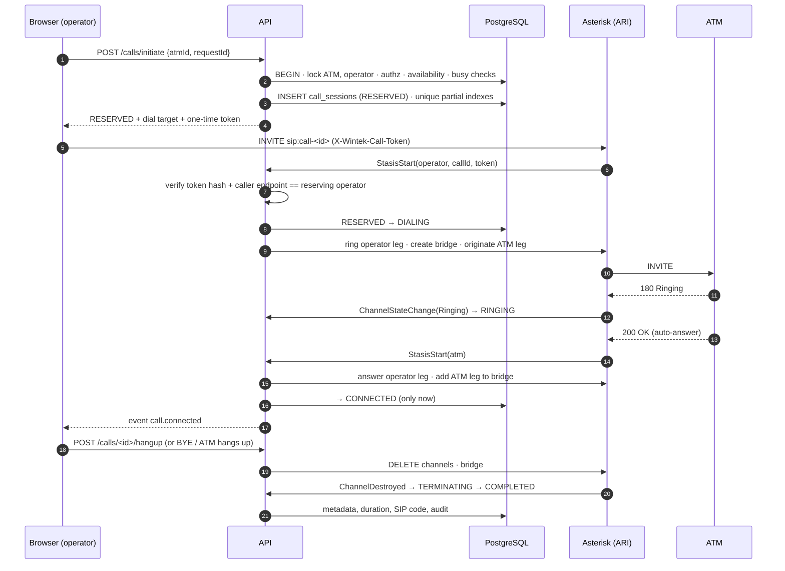

# Architecture

Wintek ATM SIP Command Center V1.1 lets security operators place audio calls
to ESP32-S3 SIP intercoms installed in ATMs. Calls are **operator-initiated
only**; the ATM auto-answers. No audio is ever recorded — only call metadata,
device events and audit logs.

## Components

```mermaid
flowchart LR
  subgraph Browser["Operator workstation (browser)"]
    UI["Dashboard SPA<br/>React · TanStack Query · Zustand"]
    UA["SIP.js softphone<br/>SIP/WSS · DTLS-SRTP"]
  end
  subgraph App["Application tier (stateless, N replicas)"]
    API["NestJS API<br/>REST · WebSocket /ws · workers"]
  end
  subgraph Data
    PG[("PostgreSQL<br/>durable state")]
    RD[("Redis<br/>fan-out · sequences")]
  end
  subgraph SIP["SIP / media tier"]
    KAM["Kamailio<br/>edge + registrar (stage 2)"]
    AST["Asterisk<br/>PJSIP · ARI · bridging"]
    TURN["coturn"]
  end
  ATM["ATM intercom<br/>ESP32-S3 · G.711 RTP"]
  VMS["Customer CCTV/VMS<br/>(external, optional)"]

  UI -- HTTPS REST --> API
  UI -- WSS events --> API
  UA -- SIP over WSS --> AST
  UA -. media DTLS-SRTP .- AST
  UA -. relay when needed .- TURN
  API -- ARI REST + events --> AST
  API --- PG
  API --- RD
  ATM -- REGISTER (stage 2) --> KAM
  KAM -- registration webhook --> API
  AST -- INVITE via trunk (stage 2) --> KAM --> ATM
  ATM -- REGISTER (stage 1) --> AST
  AST -. RTP G.711 .- ATM
  UI -. deep link .-> VMS
```

| Component | Responsibility | State |
|-----------|----------------|-------|
| Dashboard | Operator/supervisor/admin UI, softphone, real-time view | none (session in memory, refresh token in httpOnly cookie) |
| API | Auth, RBAC, inventory, routing, **call authority**, queue, audit, events | stateless; all durable state in PostgreSQL |
| PostgreSQL | System of record: devices, identities (HA1 only), assignments, calls, queue, presence, audit | durable |
| Redis | Cross-node event fan-out, per-org event sequence, 5,000-event replay buffer | transient — losing it costs freshness, never correctness |
| Asterisk | Media: bridges browser (Opus/G.711 over DTLS-SRTP) to ATM (G.711 RTP), executes ARI commands | channels only |
| Kamailio | Stage 2 SIP edge and registrar for ATMs, flood protection, NAT keepalive | usrloc (DB-backed) |

## Why ARI and not AMI for call control

ARI's Stasis model gives one application exclusive, event-driven ownership of
channels and bridges. That is exactly "the server decides": every operator
INVITE lands in the `wintek` Stasis app, the API validates it, and only then
originates the ATM leg. AMI is a monitoring/command channel without channel
ownership; it is **not used** for call control. It may later be used read-only
for node statistics.

## The call path



Key properties:

* **CONNECTED is never inferred from an HTTP success.** It is set only after
  the ATM channel is Up and both legs are bridged.
* The browser cannot dial an ATM directly: the only routable extension for
  operators is `call-<id>` into Stasis; ATMs' dialplan context only hangs up.
* The dial token is one-time, stored as a SHA-256 hash, bound to the
  reserving operator's authenticated SIP endpoint, and cleared once used.

## Registrar authority (no split brain)

| Stage | Registrar for ATMs | How Asterisk reaches an ATM | API `ATM_DIAL_MODE` |
|-------|--------------------|------------------------------|---------------------|
| **1** — pilot / single site, up to a few thousand ATMs | Asterisk PJSIP (realtime views `ast_ps_*` over `sip_identities`) | `PJSIP/<atm-user>` | `asterisk-registrar` |
| **2** — 20,000 ATMs, HA | Kamailio (`kamailio_subscriber` view, usrloc in DB) | `PJSIP/<atm-user>@kamailio` trunk | `kamailio` |

Exactly one registrar is authoritative per deployment. In stage 2 the ATM
endpoints are removed from Asterisk's view of the world, so an ATM can't
register in two places. Operator browsers always register to Asterisk
(WSS), because their media terminates there.

Why switch at scale: 20,000 devices refreshing every 300 s is ~67
REGISTERs/s plus NAT keepalives. Kamailio handles that on one core and keeps
registration state independent of media nodes, so an Asterisk restart drops
calls on that node but **does not** de-register the fleet; media nodes can be
added behind Kamailio without re-provisioning devices.

## Durable vs transient state (PostgreSQL and Redis)

The rule: **PostgreSQL is written first; Redis only distributes news about it.**

| Data | PostgreSQL | Redis |
|------|-----------|-------|
| Calls, call events, queue, assignments, audit | record | — |
| Operator presence | record (row updated per heartbeat, ~20 writes/s at 200 operators) | — |
| ATM registration | snapshot written on change; `last_seen_at` at most once a minute per device | — |
| Real-time events | — | per-org `INCR` sequence, sorted-set replay buffer, pub/sub to API nodes |
| Rate limits | — | in-process (per node); can move to Redis storage |

Consistency follows from ordering: an event is published only **after** the
transaction that changed the row commits. If Redis is down, events are
delivered to the local node's clients unsequenced (`seq = 0`), clients apply
them by `entityVersion`, and when sequencing resumes every client is told to
resync from REST. A lost event therefore makes a screen briefly stale; it
never makes the system wrong, and the stale indicator says so.

## Concurrency guarantees

* One active call per ATM and per operator: partial unique indexes on
  `call_sessions(atm_id)` / `(operator_id)` over the active states, plus row
  locks taken in a fixed order (ATM, then operator) during reservation.
* Idempotent initiation: unique `(operator_id, request_id)`.
* No stale locks: there are no application locks to go stale. Reservations
  are rows with timeouts; the sweeper (one node at a time via
  `pg_try_advisory_lock`) expires every non-terminal state, and the media
  reconciler closes calls whose channels vanished.
* Overlapping supervisor overrides are impossible: an exclusion constraint on
  `(atm_id, tstzrange(starts_at, ends_at))`.
* Concurrent admin edits of the same assignment: optimistic concurrency
  (`expectedVersion` → `409 STALE_VERSION`).

## Capacity model

| Quantity | Design target | Notes |
|----------|---------------|-------|
| Registered ATMs | 20,000 (schema/indexes tested with 2,000 seeded; seed supports 20,000) | registration load lives on the registrar |
| Concurrent calls | ~200 initial target, `MAX_CONCURRENT_CALLS` guard (default 250) | **to be confirmed by load test** of Asterisk transcoding (Opus↔G.711) per node |
| Operators online | hundreds | presence ~20–100 small writes/s |
| Dashboard clients | hundreds per API node | events coalesced client-side (≤1 refetch/s/key) |

Distinguish: *registered* devices (registrar contacts), *online* (registered
and active), *concurrent calls* (active states), *operator sessions*
(heartbeat-fresh).

## High availability (production topology)

* API: ≥2 replicas behind the reverse proxy; stateless; jobs self-elect per tick.
* PostgreSQL: primary + synchronous standby (Patroni or managed service);
  PITR backups. The API reconnects through the pool.
* Redis: Sentinel or managed; optional for correctness.
* Kamailio: 2 nodes with a shared DB-backed usrloc and a floating IP / DNS SRV
  for ATMs.
* Asterisk: N media nodes; new calls go to healthy nodes. **An active call
  does not survive the loss of its media node** — the call is ended, recorded
  as FAILED ("media channels lost") and the operator can call again in seconds.
  See [failover.md](failover.md).
