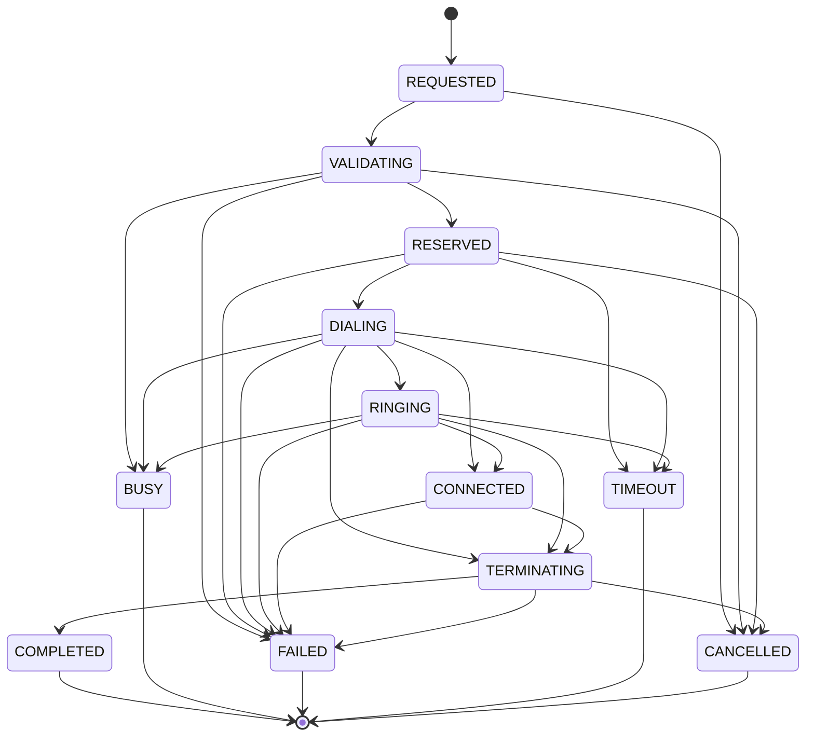

# Call lifecycle, concurrency and busy handling

Source of truth: `packages/shared/src/call-state.ts` (state machine, timeouts)
and `apps/api/src/modules/calls/calls.service.ts` (the only writer of call state).

## States

| State | Meaning | Holds ATM + operator? | Entered on |
|-------|---------|----------------------|------------|
| IDLE | (conceptual start) | — | — |
| REQUESTED | Initiate request accepted for processing | — | API (timeline row) |
| VALIDATING | Authorization, availability, busy checks | — | API (timeline row) |
| RESERVED | Reservation committed; waiting for the console's INVITE | **yes** | API, in the reservation transaction |
| DIALING | Operator leg in Stasis, token verified, ATM leg being originated | **yes** | ARI StasisStart (operator) |
| RINGING | ATM sent 180 | **yes** | ARI ChannelStateChange=Ringing |
| CONNECTED | ATM answered **and** both legs bridged | **yes** | ARI StasisStart (ATM) + successful bridge |
| TERMINATING | Hang-up in progress | **yes** | API hangup, ARI leg end, max duration |
| COMPLETED | Ended after being connected | no | ARI ChannelDestroyed / sweeper |
| BUSY | ATM rejected busy (486/600) | no | ARI |
| FAILED | Error (bad bridge, 5xx, media lost, dial failure) | no | ARI / sweeper |
| TIMEOUT | No answer (408/480) or a state timer expired | no | ARI / sweeper |
| CANCELLED | Ended before connecting (operator hung up, cancelled while RESERVED) | no | API / ARI |

## Transitions

Any transition not listed is rejected (`InvalidCallTransitionError`); late or
duplicate ARI events are ignored rather than applied out of order. Every
applied transition writes a `call_events` row (from, to, source, SIP code).

## Timeouts and cleanup

| State | Limit | On expiry |
|-------|-------|-----------|
| REQUESTED / VALIDATING | 5 s | CANCELLED |
| RESERVED | 15 s | TIMEOUT (console never dialled) |
| DIALING | 10 s | TIMEOUT |
| RINGING | 30 s | TIMEOUT (covers a configured auto-answer delay) |
| TERMINATING | 10 s | COMPLETED if it was answered, else CANCELLED |
| CONNECTED | 60 min max duration | TERMINATING (system hang-up) |

The sweeper runs every 2 s on exactly one API node and always hangs up any
remaining channels. A crashed API node therefore cannot leave an ATM or
operator reserved for more than these limits. The media reconciler (every
30 s) ends calls whose channels no longer exist on their Asterisk node.

## Concurrency rules (enforced server-side)

| Rule | Mechanism |
|------|-----------|
| Max one active call per ATM | `ux_call_active_atm` partial unique index + ATM row lock |
| Max one active call per operator | `ux_call_active_operator` partial unique index + operator row lock + live availability check |
| No duplicate dialing | idempotency on `(operator_id, request_id)`; the dial token is one-time; the console refuses a second INVITE |
| No conflicting reservations | single transaction, fixed lock order, unique indexes as backstop (race losers get `ATM_BUSY` / `OPERATOR_BUSY`) |
| No stale locks | no app-level locks; time-bounded states + sweeper |
| No unauthorized initiation | permission `call:initiate` + assignment/region authorization in the same transaction; the INVITE must come from the reserving operator's SIP identity with the matching token |
| Capacity | `MAX_CONCURRENT_CALLS` → `503 CAPACITY` |

Integration tests (`apps/api/test/calls.int.test.ts`) fire six concurrent
initiations at one ATM and two concurrent initiations by one operator, and
assert exactly one reservation each time.

## Busy handling

* **ATM busy:** `409 ATM_BUSY` with `details.queueAllowed`. If the caller set
  `queueIfBusy` and the routing policy allows it, the request is queued
  instead (`queued: true`) with the caller as preferred operator. When the
  ATM frees up the dispatcher offers it back (see routing-and-queue.md).
* **Operator busy:** `409 OPERATOR_BUSY`. Pending work is routed to someone
  else by the dispatcher; supervisors see escalations.
* **No active-call preemption in V1.1** — not even for P1. The schema
  enforces it (`routing_policies.allow_preemption` is constrained to false).

## Idempotent initiation

Clients send a `requestId` per user action (the dashboard generates one per
click and reuses it for a network retry). A repeat returns the same call
(`replayed: true`). While the call is still RESERVED the replay carries a new
one-time token and the previous token stops working.

## Error codes returned by `POST /calls/initiate`

`NOT_AN_OPERATOR`, `NOT_FOUND`, `OPERATOR_DISABLED`, `NOT_AUTHORIZED`,
`ATM_DISABLED`, `ATM_OFFLINE`, `OPERATOR_BUSY`, `OPERATOR_UNAVAILABLE`,
`ATM_BUSY`, `CAPACITY`, `VALIDATION_FAILED`, `RATE_LIMITED`. Every refusal is
audited (`call.initiate.rejected`, outcome DENIED or FAILURE).
