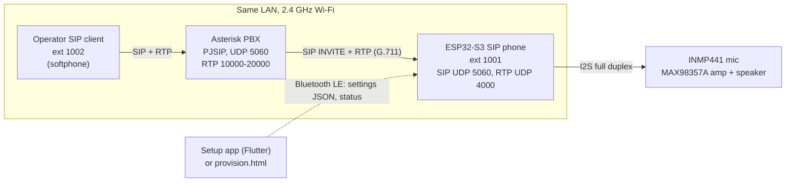
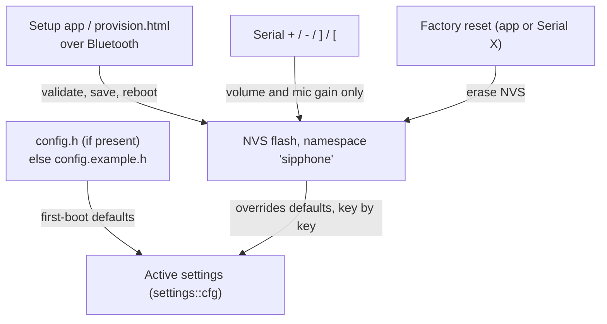
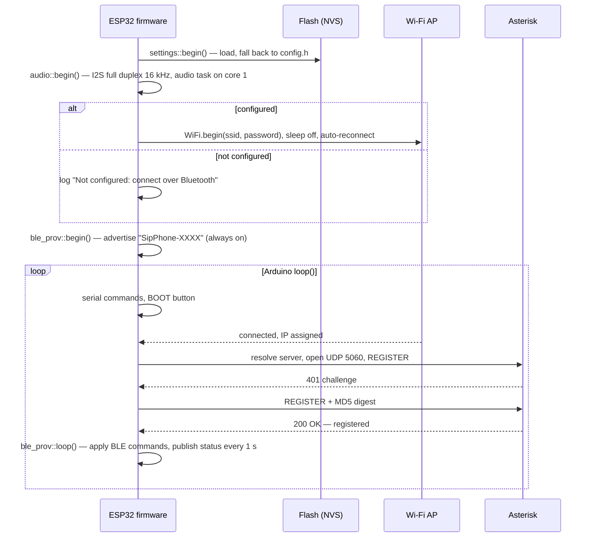

# ESP32-S3 SIP Phone — System and Setup Guide

This guide covers the whole project as of 2026-11-06: the SIP server the phone registers to, how the firmware starts and configures itself, the Bluetooth setup app, and the steps to get from parts on a bench to a working call.

Per-component detail lives in:

| File | Covers |
| --- | --- |
| [ESP32S3_SipPhone/README.md](../ESP32S3_SipPhone/README.md) | Phone firmware: settings, BLE protocol, controls, troubleshooting |
| [sipphone_setup_app/README.md](../sipphone_setup_app/README.md) | Flutter setup app |
| [ESP32S3_AudioWebTest/README.md](../ESP32S3_AudioWebTest/README.md) | Mic/speaker bench test sketch |
| [ESP32_CIRCUIT_NOTES.md](../ESP32_CIRCUIT_NOTES.md) | Circuit intent and known errors in the original drawing |
| [BUILD.md](../BUILD.md) | `build.bat` options |

---

## 1. System overview



- **Asterisk** is the SIP server. It is not part of this repository; you install and run it on a PC, Raspberry Pi or server on the same LAN.
- **The ESP32-S3** runs `ESP32S3_SipPhone`. It registers to Asterisk as extension `1001` and **only receives calls** (it auto-answers by default). There are no outgoing calls.
- **The operator** uses any SIP softphone registered as `1002` and dials `1001`.
- **The setup app** (or the browser page `provision.html`) writes Wi-Fi and SIP settings to the phone over Bluetooth LE. Settings are stored in the ESP32's flash (NVS).

Audio path: mic → I2S 16 kHz → DC block + gain → decimate to 8 kHz → G.711 (PCMU/PCMA) → 20 ms RTP packets → Asterisk → operator. The return path runs through a 60 ms jitter buffer, decode, interpolation to 16 kHz, volume, and out to the amplifier.

---

## 2. What you need

### Hardware

| Part | Notes |
| --- | --- |
| ESP32-S3 dev board, ≥ 4 MB flash | PSRAM not needed for the SIP phone (it is needed for the AudioWebTest bench sketch) |
| INMP441 I2S microphone | 3.3 V |
| MAX98357A I2S amplifier | 5 V |
| Speaker, 4 Ω 3 W | Across SPK+ / SPK−, neither lead to ground |
| Regulated 5 V supply, ≥ 1 A | Common ground with the ESP32 |

### Software

| Tool | Version used | For |
| --- | --- | --- |
| Arduino CLI | 1.5.1 | Building and flashing the firmware via `build.bat` |
| Arduino core `esp32:esp32` | **3.3.12** | ESP32-S3 support (no other libraries needed) |
| Flutter | 3.47 (Dart SDK ^3.13.7) | Setup app; only if you build the app |
| Asterisk | 18 or newer with PJSIP | SIP server |
| A SIP softphone | e.g. Linphone, MicroSIP, Zoiper | Operator extension 1002 |
| Chrome or Edge | any current | Only if you use `provision.html` instead of the app |

Install the Arduino core once:

```bash
arduino-cli core update-index
```

```bash
arduino-cli core install esp32:esp32@3.3.12
```

---

## 3. Wiring

| ESP32-S3 | Connects to | Purpose |
| --- | --- | --- |
| GPIO4 | INMP441 SCK **and** MAX98357A BCLK | Shared I2S bit clock |
| GPIO5 | INMP441 WS **and** MAX98357A LRC | Shared I2S word clock |
| GPIO6 | INMP441 SD | Mic audio in |
| GPIO7 | MAX98357A DIN | Speaker audio out |
| 3V3 | INMP441 VDD | Mic supply |
| GND | INMP441 GND + L/R, amp GND, supply GND | Common ground |
| Regulated 5 V | MAX98357A VIN | Amp supply |
| GPIO0 (BOOT button) | on-board | Answer / hang up |

Keep the 3.3 V and 5 V rails separate. The original circuit drawing has rail and ground mistakes; follow this table and [ESP32_CIRCUIT_NOTES.md](../ESP32_CIRCUIT_NOTES.md). Set the amplifier's SD/EN and GAIN pins according to your breakout's schematic.

Pins are build-time only. To change them, edit `config.h` (see §6.3).

---

## 4. SIP server (Asterisk)

The phone needs a SIP registrar on the same LAN that it can reach directly over UDP. There is no NAT/STUN/TLS support, so the server must not be on the internet behind NAT relative to the phone.

### 4.1 Install

On Debian / Ubuntu / Raspberry Pi OS:

```bash
sudo apt update && sudo apt install -y asterisk
```

On Windows, run Asterisk inside WSL2 or a Linux VM. With WSL2, use mirrored networking (or a bridged VM) so the ESP32 can reach it on the LAN IP; the default NAT mode of WSL2 will block incoming SIP from the phone.

Note the server's LAN IP (`ip -4 addr` / `hostname -I`), for example `192.168.1.50`. This is what goes into the phone's **SIP server** field.

### 4.2 Configure the endpoints

`/etc/asterisk/pjsip.conf` — a UDP transport, the phone (1001) and the operator (1002):

```ini
[transport-udp]
type=transport
protocol=udp
bind=0.0.0.0:5060

; ---- ESP32 phone ----
[1001]
type=endpoint
transport=transport-udp
context=internal
disallow=all
allow=ulaw,alaw
auth=1001
aors=1001
direct_media=no
rtp_symmetric=yes
force_rport=yes
rewrite_contact=yes

[1001]
type=auth
auth_type=userpass
username=1001
password=change-me-1001

[1001]
type=aor
max_contacts=1
qualify_frequency=30

; ---- Operator softphone ----
[1002]
type=endpoint
transport=transport-udp
context=internal
disallow=all
allow=ulaw,alaw
auth=1002
aors=1002
direct_media=no
rtp_symmetric=yes
force_rport=yes
rewrite_contact=yes

[1002]
type=auth
auth_type=userpass
username=1002
password=change-me-1002

[1002]
type=aor
max_contacts=1
```

Why these options matter for the ESP32:

- `allow=ulaw,alaw` — the phone only speaks G.711 PCMU/PCMA. An offer without them is rejected.
- `direct_media=no` — keeps RTP flowing through Asterisk, so the phone and softphone never need to reach each other directly.
- `rtp_symmetric=yes`, `force_rport=yes` — Asterisk replies to the address packets actually came from.
- `qualify_frequency=30` — Asterisk pings the phone with OPTIONS, which the firmware answers; `pjsip show contacts` then shows it as *Avail*.

`/etc/asterisk/extensions.conf` — let each extension dial the other:

```ini
[internal]
exten => 1001,1,Dial(PJSIP/1001,30)
 same => n,Hangup()

exten => 1002,1,Dial(PJSIP/1002,30)
 same => n,Hangup()
```

`/etc/asterisk/rtp.conf` (default range, shown so you can open it in the firewall):

```ini
[general]
rtpstart=10000
rtpend=20000
```

Use real passwords. The SIP password you set for `1001` is the one you enter in the setup app.

### 4.3 Start the server

```bash
sudo systemctl enable --now asterisk
```

After editing the config files, reload without dropping the service:

```bash
sudo asterisk -rx "core reload"
```

Open the firewall if one is active (UFW example):

```bash
sudo ufw allow 5060/udp && sudo ufw allow 10000:20000/udp
```

**WSL2 in mirrored mode:** WSL has its own Hyper-V firewall, separate from the normal Windows Firewall rules, and it blocks incoming traffic by default. Allow SIP and RTP from your LAN in an **administrator** PowerShell. Replace `192.168.1.0/24` with your own subnet: take the PC's IPv4 address from `ipconfig` and change the last number to `0/24`. If the subnet is wrong, Asterisk never sees the phone and the phone logs `registration failed: no response`.

```powershell
$wsl = '{40E0AC32-46A5-438A-A0B2-2B479E8F2E90}'
New-NetFirewallHyperVRule -Name WSL-Asterisk-SIP -DisplayName "WSL Asterisk SIP UDP 5060" -Direction Inbound -VMCreatorId $wsl -Protocol UDP -LocalPorts 5060 -RemoteAddresses 192.168.1.0/24 -Action Allow
New-NetFirewallHyperVRule -Name WSL-Asterisk-RTP -DisplayName "WSL Asterisk RTP Audio" -Direction Inbound -VMCreatorId $wsl -Protocol UDP -LocalPorts 10000-20000 -RemoteAddresses 192.168.1.0/24 -Action Allow
```

Check them with `Get-NetFirewallHyperVRule -VMCreatorId $wsl | Where-Object Name -like 'WSL-Asterisk*' | Format-Table Name,LocalPorts,RemoteAddresses,Enabled`. If the rules already exist with the wrong subnet or port range, fix them in place:

```powershell
Set-NetFirewallHyperVRule -Name WSL-Asterisk-SIP,WSL-Asterisk-RTP -RemoteAddresses 192.168.1.0/24
Set-NetFirewallHyperVRule -Name WSL-Asterisk-RTP -LocalPorts 10000-20000
```

To test from another device, not the PC itself: in mirrored mode the PC can't reach WSL on its own LAN IP unless `hostAddressLoopback=true` is set in `.wslconfig`.

### 4.4 Check it is running

```bash
sudo asterisk -rvvv
```

Useful commands at the `CLI>` prompt:

| Command | Shows |
| --- | --- |
| `pjsip show transports` | UDP 5060 is bound |
| `pjsip show endpoints` | 1001 and 1002 exist |
| `pjsip show contacts` | Which extensions are registered, and their IP |
| `pjsip set logger on` | Every SIP message (turn off with `off`) |
| `rtp set debug on` | RTP packets per call |

Register the operator softphone as `1002` (server = Asterisk IP, port 5060, UDP, user/auth user `1002`, the 1002 password) and confirm it shows in `pjsip show contacts` before moving on.

---

## 5. Firmware: build and flash

All commands run from the repository root in PowerShell. `build.bat` builds `ESP32S3_AudioWebTest` by default; set `AUDIO_SKETCH` to build the phone.

### 5.1 Bench-test the audio first (recommended)

`ESP32S3_AudioWebTest` checks the mic and speaker in a browser before SIP is involved. Set `WIFI_SSID` / `WIFI_PASSWORD` at the top of its `.ino`, then:

```powershell
.\build.bat COM5
```

Open the IP printed on the serial monitor, play the bundled `test-tone-16k-mono.wav` and record the mic. This sketch requires PSRAM. See its [README](../ESP32S3_AudioWebTest/README.md).

### 5.2 Build and flash the SIP phone

```powershell
$env:AUDIO_SKETCH='ESP32S3_SipPhone'
.\build.bat COM5
```

| Command | Does |
| --- | --- |
| `.\build.bat compile` | Compile only, no board needed |
| `.\build.bat COM5 upload` | Compile and upload |
| `.\build.bat COM5 monitor` | Serial monitor only (115200 baud) |
| `.\build.bat COM5` | Compile, upload, monitor |
| `.\build.bat` | Same, auto-detecting the port if only one ESP32 is connected |

For the SIP phone the script automatically uses the **Minimal SPIFFS (1.9 MB app with OTA)** partition scheme, because Wi-Fi plus Bluetooth does not fit the default 1.2 MB app slot. Default board options are native USB CDC, QIO, 16 MB flash, OPI PSRAM. Override them for your module:

```powershell
$env:AUDIO_FQBN='esp32:esp32:esp32s3:USBMode=hwcdc,CDCOnBoot=cdc,FlashMode=qio,FlashSize=4M,PartitionScheme=min_spiffs,PSRAM=disabled'
```

Firmware images go to `release\`, build intermediates to `.build\`. If the upload fails, hold BOOT, tap RESET, release BOOT, and retry. If the COM number changes after upload, rerun `monitor` with the new port.

### 5.3 Later updates over Wi-Fi

Once the phone is on Wi-Fi, later firmware can go over the network instead of USB: set an **Update password** in the setup app, build with `.\build.bat compile`, open `http://<phone-ip>/update` (user `admin`) and upload `release\ESP32S3_SipPhone.ino.bin`. The phone writes it to its second firmware slot, restarts, and keeps it only if Wi-Fi is up for 30 s after the restart; otherwise it rolls back to the previous firmware. Bump `FW_VERSION` in `ESP32S3_SipPhone/version.h` for each release so the app and `s` show which version is running. Details: [ESP32S3_SipPhone/README.md](../ESP32S3_SipPhone/README.md#update-firmware-over-wi-fi).

Arduino IDE alternative: board *ESP32S3 Dev Module*, core 3.3.12, Tools → Partition Scheme → *Minimal SPIFFS*, USB CDC On Boot enabled, open `ESP32S3_SipPhone/ESP32S3_SipPhone.ino`, upload.

---

## 6. Firmware configuration

### 6.1 Where settings come from



1. **Build-time defaults** — `app_config.h` includes `config.h` when it exists, otherwise `config.example.h`. These provide the pins and the values used on first boot or after a factory reset.
2. **Saved settings (NVS)** — whatever was saved over Bluetooth. Any key present in flash overrides the build-time default.
3. **Bluetooth** — the normal way to configure the phone. Saving validates the settings, writes them to NVS and restarts the phone.

### 6.2 Settings reference

| Setting | JSON key (BLE) | Default | Valid range |
| --- | --- | --- | --- |
| Wi-Fi SSID | `wifi_ssid` | empty | 1–32 chars, 2.4 GHz network |
| Wi-Fi password | `wifi_password` | empty | empty (open network) or 8–63 chars |
| SIP server | `sip_server` | empty | IP or hostname, 1–64 chars |
| SIP server port | `sip_server_port` | 5060 | 1–65535 |
| SIP domain | `sip_domain` | empty = SIP server | ≤ 64 chars |
| Extension / user | `sip_user` | 1001 | 1–32 chars |
| Auth user | `sip_auth_user` | empty = user | ≤ 32 chars |
| SIP password | `sip_password` | empty | ≤ 64 chars |
| Registration expiry | `sip_expires` | 300 s | 60–86400 |
| Local SIP port | `sip_local_port` | 5060 | 1–65535, ≠ RTP port |
| Local RTP port | `rtp_local_port` | 4000 | 1–65535 |
| Auto-answer delay | `auto_answer_ms` | 1000 ms | −1 (manual only) to 60000 |
| Mic gain | `mic_gain` | 4 | 1–32 |
| Speaker volume | `speaker_volume` | 60 % | 0–100 |
| Update password | `ota_password` | empty = Wi-Fi updates off | empty or 8–64 chars |

The phone counts as **configured** once Wi-Fi SSID, SIP server and SIP user are all set. Passwords are write-only: the phone reports only `wifi_password_set` / `sip_password_set` / `ota_password_set`, and an empty password field in the app keeps the stored one.

### 6.3 Baking settings into the firmware (optional)

To ship a phone that works without Bluetooth setup, copy the template and fill it in:

```powershell
Copy-Item ESP32S3_SipPhone\config.example.h ESP32S3_SipPhone\config.h
```

`config.h` is git-ignored, so credentials stay out of the repository. It is also the only place to change the I2S pins (`I2S_BCLK_PIN`, `I2S_WS_PIN`, `I2S_MIC_PIN`, `I2S_SPEAKER_PIN`) and the answer button (`ANSWER_BUTTON_PIN`). Settings saved later over Bluetooth still take precedence.

---

## 7. How the phone starts



Step by step (`ESP32S3_SipPhone.ino`, `setup()` then `loop()`):

1. **Serial** opens at 115200 and prints `=== ESP32-S3 SIP phone ===`.
2. **Settings** load from NVS, falling back to `config.h` defaults.
3. **Audio** starts: one full-duplex I2S port at 16 kHz / 32-bit with a FreeRTOS task on core 1. It plays silence (or the ring tone) until a call opens RTP. Logs `[AUDIO] I2S full duplex 16 kHz running`.
4. **Wi-Fi** — only if configured: station mode, power save **off** (it adds RTP latency), auto-reconnect on, join the SSID. Logs `[WIFI] joining <ssid>...`.
5. **Bluetooth** advertises as `SipPhone-XXXX` (last bytes of the MAC) every 0.5–1 s and stays on permanently, including during calls.
6. **Main loop** runs `sip::loop()` and `ble_prov::loop()` continuously.

How the SIP client starts inside `sip::loop()`:

- It does nothing until the phone is configured **and** Wi-Fi is connected.
- On Wi-Fi up it resolves the SIP server name, opens the local UDP SIP port, generates a fresh Call-ID and tag, and sends `REGISTER`. If resolving or opening the port fails, it logs the reason and retries every 5 s.
- `401`/`407` → it answers the MD5 digest challenge (up to 2 tries). `423` → it adopts the server's `Min-Expires`.
- `200 OK` → `[SIP] registered as 1001@<server> (expires 300s)`. It re-registers 30 s before expiry.
- No response → retransmits at 0.5, 1, 2, 4 s…; after 16 s it logs `registration failed: no response from <server>` and retries in 15 s. Other errors retry in 30 s.
- Wi-Fi lost → ends any call, closes the socket, and starts again from the top when Wi-Fi returns.

Typical healthy boot log:

```text
=== ESP32-S3 SIP phone ===
[AUDIO] I2S full duplex 16 kHz running
SIP 1001@192.168.1.50:5060, auto-answer 1000 ms
[WIFI] joining MyWiFi...
[BLE] advertising as "SipPhone-A1B2": connect with the setup app or page
[WIFI] connected, IP 192.168.1.80, RSSI -52 dBm
[SIP] local 192.168.1.80:5060, server 192.168.1.50:5060
[SIP] registered as 1001@192.168.1.50 (expires 300s)
```

### Incoming call

1. Asterisk sends `INVITE`; the phone answers `100 Trying`, `180 Ringing` and plays a ring tone (1 s on, 3 s off). A second call while busy gets `486 Busy`.
2. After `auto_answer_ms` (default 1 s), or on BOOT press / Serial `a` when it is −1, the phone sends `200 OK` with SDP offering the codec chosen from the caller's offer (PCMU or PCMA).
3. On `ACK` the call is active and RTP flows on local UDP port 4000.
4. Either side hangs up with `BYE`; a caller who gives up while ringing sends `CANCEL` (answered with `487`). re-INVITEs (hold, media change) are accepted.

---

## 8. Setup app

### 8.1 Flutter app (Android / iOS)

```bash
cd sipphone_setup_app
```

```bash
flutter pub get
```

```bash
flutter run
```

Or build an Android install package:

```bash
flutter build apk --release
```

The APK is written to `build/app/outputs/flutter-apk/app-release.apk`.

Permissions are already declared: on Android, *Nearby devices* (`BLUETOOTH_SCAN`, `BLUETOOTH_CONNECT`; location only on Android 11 and older); on iOS, `NSBluetoothAlwaysUsageDescription`. Grant them on first scan.

The BLE plugin `flutter_blue_plus` is used under its non-profit licence (`License.nonprofit` in `lib/src/phone_session.dart`). Commercial use needs its commercial licence.

App structure:

| File | Role |
| --- | --- |
| `lib/src/protocol.dart` | Service/characteristic UUIDs, config and status JSON models |
| `lib/src/phone_session.dart` | Connect, chunked save (MTU − 3, 20–180 bytes), commands, reconnect after restart |
| `lib/src/screens/scan_screen.dart` | Lists nearby `SipPhone-XXXX` devices with signal strength |
| `lib/src/screens/setup_screen.dart` | Live status plus the settings form |

Run the tests (layout is checked from 320 px to 1440 px in light and dark themes):

```bash
flutter test
```

### 8.2 Browser alternative: `provision.html`

No build needed. Open `ESP32S3_SipPhone/provision.html` in **Chrome or Edge** (Windows, macOS, Linux, Android), or serve it locally:

```bash
python -m http.server --directory ESP32S3_SipPhone 8000
```

Then open `http://localhost:8000/provision.html`. On iPhone use the Bluefy browser; Safari and Firefox lack Web Bluetooth.

### 8.3 Bluetooth protocol (for reference or a generic BLE app)

Service `6b3f0001-7c1a-4d2e-9b8f-2a1c5e7d9f01`:

| Characteristic | UUID | Access | Content |
| --- | --- | --- | --- |
| Config | `6b3f0002-…` | read / write, encrypted | Settings JSON (keys from §6.2), max 2048 bytes |
| Command | `6b3f0003-…` | write, encrypted | `begin`, `save`, `reboot`, `factory_reset` |
| Status | `6b3f0004-…` | read / notify (1 s) | `configured`, `wifi`, `ip`, `rssi`, `sip`, `sip_detail`, `call`, `fw`, `ota_url`, `result`, `detail` |

Save sequence: write `begin` to Command → write the JSON to Config in one or more chunks (appended) → write `save`. Keys you leave out keep their values. On success Status reports `result: "saved"` and the phone restarts.

Pairing is "Just Works" with LE Secure Connections: the link is encrypted but there is no PIN. Because Bluetooth is always on, anyone within range can connect and change settings (they cannot read saved passwords).

---

## 9. End-to-end setup checklist

1. **Wire** the board, mic and amp (§3).
2. **Bench test** audio with `ESP32S3_AudioWebTest` (§5.1).
3. **Install and start Asterisk**, configure 1001 and 1002 (§4). Note the server IP and the 1001 password.
4. **Register the operator softphone** as 1002 and confirm with `pjsip show contacts`.
5. **Flash the phone**: `$env:AUDIO_SKETCH='ESP32S3_SipPhone'; .\build.bat COM5` (§5.2). The serial monitor shows `Not configured` and `[BLE] advertising as "SipPhone-XXXX"`.
6. **Open the setup app** (or `provision.html`), scan, tap `SipPhone-XXXX`, accept pairing.
7. **Enter settings**: Wi-Fi SSID and password, SIP server = Asterisk IP, port 5060, extension 1001, the 1001 password. Leave the rest at defaults. Tap **Save and restart**.
8. **Wait for the reconnect**. Status should show Wi-Fi *connected* with an IP and SIP *registered*. On Asterisk, `pjsip show contacts` lists 1001.
9. **Call**: dial `1001` from the softphone. The phone rings, auto-answers after 1 s and audio flows both ways. Keep speaker volume low; there is no echo cancellation.
10. **Disconnect the setup app** during calls to leave airtime for Wi-Fi.

---

## 10. Operating the phone

| Input | Action |
| --- | --- |
| BOOT button | Answer when ringing, otherwise hang up |
| Serial `a` / `h` | Answer / hang up or decline |
| Serial `s` | Status: Wi-Fi, registration, call, RTP counters, mic peak, Bluetooth, firmware version and update link |
| Serial `r` | Re-register now |
| Serial `+` / `-` | Speaker volume ±10 % (saved) |
| Serial `]` / `[` | Mic gain ±1 (saved) |
| Serial `X` | Factory reset (erase saved settings, restart) |
| Serial `?` | Help |

---

## 11. Troubleshooting

| Symptom | Likely cause and fix |
| --- | --- |
| `Not configured` at boot | Normal before setup. Configure over Bluetooth. |
| Phone missing from the scan | Check Serial for `[BLE] advertising`; move closer; disconnect any other device already connected to it. |
| Pairing fails after reflash / factory reset | Remove `SipPhone-XXXX` from the phone's or PC's Bluetooth devices, then reconnect. |
| Save shows an error | Read the message: it is the firmware's validation (e.g. Wi-Fi password must be 8–63 chars). |
| `[WIFI]` never connects | 2.4 GHz only; check SSID/password; guest networks with client isolation block SIP. |
| `cannot resolve <server>` | Use the server's IP instead of a hostname. |
| `registration failed: no response` | Wrong server IP/port; Asterisk not running; firewall on UDP 5060; WSL2 in NAT mode; WSL Hyper-V firewall rule limited to the wrong subnet (see §4.3). Check `pjsip show transports`. |
| Repeated `401 Unauthorized` | Password or auth user doesn't match `pjsip.conf` `[1001]` auth section. |
| Call rejected: no PCMU/PCMA | Add `allow=ulaw,alaw` to both endpoints. |
| Connected but one-way or no audio | Run `s` during the call: `rx=0` means no RTP arriving. Set `direct_media=no`, `rtp_symmetric=yes`; open the RTP range on the server firewall. |
| Choppy audio | Check `underruns`, `lost` and RSSI in `s`; close the setup app; move closer to the AP. |
| Echo or howling | No echo cancellation: lower volume (`-`) and mic gain (`[`), separate mic and speaker. |
| Upload fails | Hold BOOT, tap RESET, release BOOT; check the COM port. |
| Wi-Fi update: 403 / 401 / image rejected | 403: set an update password in the app. 401: user is `admin` with the update password. Rejected: upload `ESP32S3_SipPhone.ino.bin`, not the merged image. |
| Firmware too big for partition | Use the Minimal SPIFFS partition scheme (`build.bat` does this automatically for the SIP phone). |

---

## 12. Current limitations

- Incoming calls only; one call at a time.
- UDP only. No NAT traversal, STUN, TLS or SRTP — phone and server must be on the same LAN.
- G.711 only (PCMU/PCMA). No DTMF.
- No acoustic echo cancellation.
- Pins are build-time only (`config.h`).
- Bluetooth setup is open to anyone in range (encrypted, no PIN).
- Wi-Fi firmware updates use plain HTTP with a password; images are not signed.
- The Asterisk configuration above is an example: it is not stored or tested in this repository.
